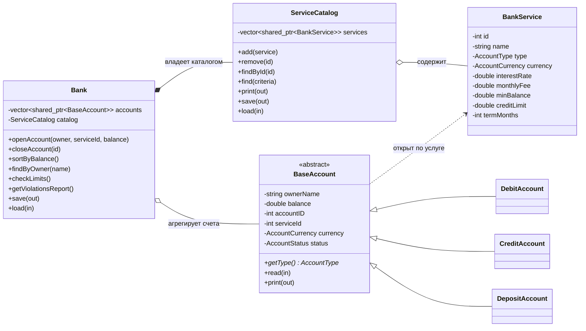

# 🏦 Консольное приложение «Банк»

Учебный проект по дисциплине **«Низкоуровневое программирование на C++»** (вариант №20).

Консольное приложение на C++ с использованием ООП. Программа моделирует работу банка: в нём есть **каталог банковских услуг** (какие типы счетов банк вообще предлагает) и **сам банк**, который хранит конкретные открытые счета клиентов. Поддерживаются поиск, сортировка, проверка лимитов и сохранение данных в файл.

---

## 📌 Идея проекта

В проекте чётко разделены два понятия:

| Понятие | Класс | Что это |
|---|---|---|
| **Услуга** | `BankService` | Описание того, что банк предлагает: «Дебетовый счёт Standard», «Депозит на 12 месяцев». Хранит условия: ставку, комиссию, лимит. Владельца и баланса у услуги нет |
| **Каталог услуг** | `ServiceCatalog` | Справочник всех услуг банка. Здесь услуги добавляются, удаляются и ищутся |
| **Счёт** | `BaseAccount` и наследники | Конкретный счёт клиента, открытый по услуге из каталога: владелец, баланс, ID, валюта, статус |
| **Банк** | `Bank` | Собирательный класс. Агрегирует все открытые счета, владеет каталогом, контролирует лимиты и открытие/закрытие счетов |

Счёт открывается так: клиент выбирает услугу из каталога → `Bank` создаёт счёт нужного типа (дебетовый, кредитный или депозитный) и добавляет его в свою структуру, проверив ограничения.

---

## 🧱 Архитектура

### Диаграмма классов



### Классы

**`BaseAccount`**: абстрактный базовый класс счёта. Хранит владельца, баланс, ID, валюту, статус и идентификатор услуги, по которой счёт открыт. Содержит чисто виртуальный метод `getType()`, а также виртуальные `read()` и `print()` для чтения из потока и вывода. Все сеттеры проверяют входные данные и бросают исключения.

**`DebitAccount`, `CreditAccount`, `DepositAccount`**: типы счетов. Реализуют `getType()` и добавляют своё поведение:

- дебетовый: баланс не может уйти в минус;
- кредитный: допустим уход в минус в пределах `creditLimit` из услуги;
- депозитный: начисление процентов по ставке из услуги.

**`BankService`**: описание услуги (id, название, тип, валюта, процентная ставка, ежемесячная комиссия, минимальный остаток, кредитный лимит, срок в месяцах). Параметры, которых у данного типа нет, равны нулю.

**`ServiceCatalog`**: каталог услуг. Хранит `vector<shared_ptr<BankService>>`. Умеет добавлять и удалять услуги, искать их по критериям (тип, валюта, ставка), выводить список и сохранять/загружать данные.

**`Bank`**: собирательный класс. Хранит `vector<shared_ptr<BaseAccount>>` и `ServiceCatalog`. Отвечает за открытие и закрытие счетов, сортировку, поиск, проверку лимитов и файловые операции.

---

## 🛠 Функциональность

### Главное меню

```
1. Каталог услуг
   1.1 Показать все услуги
   1.2 Найти услугу по критериям (тип, валюта, ставка)
   1.3 Добавить услугу в каталог
   1.4 Удалить услугу из каталога
2. Банк (открытые счета)
   2.1 Показать все открытые счета
   2.2 Открыть счёт по услуге из каталога
   2.3 Закрыть счёт
   2.4 Сортировка по балансу
   2.5 Поиск по владельцу счёта
3. Проверки и ограничения
   3.1 Проверить соответствие ограничениям (по общему числу счетов)
   3.2 Показать отчёт о нарушениях лимитов
4. Файловые операции
   4.1 Сохранить каталог и счета в файл
   4.2 Загрузить каталог и счета из файла
5. Дополнительная функция: расчёт начисленных процентов по депозиту
6. Выход
```

### Ограничения

- Общее число открытых счетов в банке ограничено константой `MAX_ACCOUNTS` (и, при необходимости, нижней границей `MIN_ACCOUNTS`).
- Счёт нельзя открыть по услуге, которой нет в каталоге.
- Услугу нельзя удалить из каталога, пока по ней открыты счета.
- Имя владельца не может быть пустым, баланс и ID не могут быть отрицательными.
- Все числовые константы вынесены в именованные `constexpr`-значения, без «магических чисел».

### Обработка исключений

Ошибки ловятся через `try-catch` в главном цикле меню, программа при этом не завершается:

| Исключение | Когда возникает |
|---|---|
| `std::invalid_argument` | некорректные данные счёта или услуги (пустое имя, отрицательный баланс) |
| `LimitExceededException` | превышен лимит числа счетов в банке |
| `std::runtime_error` | ошибка чтения или записи файла |
| неверный ввод в меню | пользователь ввёл не число или несуществующий пункт |

### Сортировка и поиск

- Сортировка счетов по балансу: `std::sort` с лямбдой.
- Поиск по владельцу: `std::find_if` / `std::copy_if` по подстроке имени.
- Поиск услуг по критериям: тип счёта, валюта, диапазон ставки.

### Файловые операции

Сохраняются два файла в папке `data/`. Поля разделяются символом `;`, одна запись на строку, поэтому ФИО с пробелами читаются корректно.

`data/catalog.txt`: каталог услуг:

```
id;название;тип;валюта;ставка;комиссия;мин.остаток;кредитный лимит;срок
```

`data/bank.txt`: открытые счета:

```
тип;id;владелец;баланс;валюта;статус;id услуги
```

При загрузке сначала читается каталог, затем счета, чтобы можно было проверить, что `id услуги` существует.

### Дополнительная функция

**Расчёт начисленных процентов по депозитному счёту.** Для счёта с услугой «депозит» считается доход за заданное число месяцев:

```
доход = баланс × ставка / 100 × месяцы / 12
```

Ставка берётся из услуги, по которой открыт счёт.

---

## 📐 Соответствие критериям оценивания

| Критерий | Баллы | Где реализовано |
|---|---|---|
| Проектирование и ООП | 15 | абстрактный `BaseAccount`, разделение `BankService` / счёт / `Bank` |
| Наследование и полиморфизм | 12 | `Debit`, `Credit`, `Deposit` + виртуальные `getType`, `read`, `print` |
| Класс каталога | 10 | `ServiceCatalog` |
| Собирательный класс | 12 | `Bank`: контролируемое открытие и закрытие счетов |
| Ограничения | 10 | `MAX_ACCOUNTS`, проверки в `Bank::checkLimits` |
| Сортировка и поиск | 10 | `sortByBalance`, `findByOwner` |
| Исключения | 8 | `Exceptions.h`, `try-catch` в `main.cpp` |
| Файлы | 8 | `save` / `load` у каталога и банка |
| Доп. функция | 8 | расчёт процентов по депозиту |
| Чистота кода | 7 | комментарии, именованные константы |

---

## 📁 Структура репозитория

```
project2_bank/
│
├── CMakeLists.txt            # Сборка проекта
├── README.md                 # Описание проекта
├── main.cpp                  # Точка входа: консольное меню
├── .gitignore
│
├── docs/
│   └── Task.pdf              # Текст задания
│
├── data/                     # Файлы сохранения
│   ├── catalog.txt           # Каталог услуг
│   └── bank.txt              # Открытые счета
│
└── include/
    ├── Headers.h             # Общие #include и вспомогательные определения
    ├── Exceptions.h          # Собственные исключения
    ├── Bank.h                # Собирательный класс Bank
    │
    ├── accounts/
    │   ├── BaseAccount.h     # Абстрактный счёт, enum типов, валют и статусов
    │   ├── DebitAccount.h
    │   ├── CreditAccount.h
    │   └── DepositAccount.h
    │
    └── catalog/
        ├── BankService.h     # Описание одной услуги
        └── ServiceCatalog.h  # Каталог услуг
```

---

## 🚀 Сборка и запуск

Требования: компилятор с поддержкой **C++17**, **CMake 3.15+**.

```bash
git clone https://github.com/petrukovichigor/project2_bank.git
cd project2_bank
cmake -S . -B build
cmake --build build
./build/project2_bank        # Windows: build\project2_bank.exe
```

Проект можно также открыть как CMake-проект в CLion.

---

## 🧰 Использованные возможности C++

- ООП: абстрактные классы, наследование, виртуальные функции, виртуальный деструктор;
- умные указатели `std::shared_ptr`, `std::make_shared`;
- контейнеры и алгоритмы STL: `std::vector`, `std::sort`, `std::find_if`, `std::copy_if`;
- лямбда-выражения;
- перегрузка `operator<<` и `operator>>`;
- исключения: `try` / `catch` / `throw`, собственные классы исключений;
- потоки ввода-вывода: `std::ifstream`, `std::ofstream`, `std::stringstream`;
- `enum class` для типов счетов, валют и статусов.
