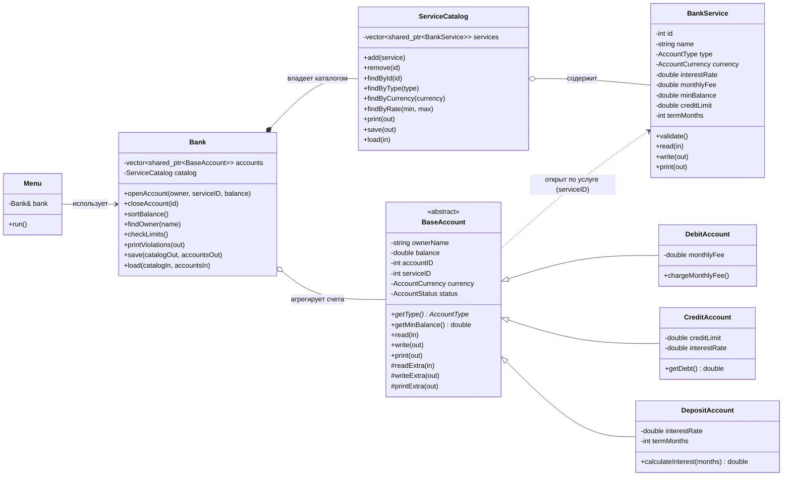

# 🏦 Консольное приложение «Банк»

Учебный проект по дисциплине **«Низкоуровневое программирование на C++»**, вариант 20.

Программа моделирует работу банка: есть **каталог банковских услуг** (какие счета банк предлагает и на каких условиях) и **сам банк**, в котором хранятся конкретные открытые счета клиентов. Счёт открывается по услуге из каталога. Поддерживаются поиск, сортировка, проверка ограничений, сохранение и загрузка данных из файлов.

---

## 📌 Идея проекта

В проекте разделены два понятия:

| Понятие | Класс | Что это |
|---|---|---|
| **Услуга** | `BankService` | Описание того, что предлагает банк: «Дебетовый Premium», «Депозит 12 мес». Хранит условия: тип счёта, валюту, ставку, комиссию, лимит, срок. Владельца и баланса у услуги нет |
| **Каталог услуг** | `ServiceCatalog` | Справочник всех услуг банка (в задании он назван `AccountCatalog`): добавление, удаление, поиск, сохранение, загрузка |
| **Счёт** | `BaseAccount` и наследники | Конкретный счёт клиента, открытый по услуге: владелец, баланс, ID, валюта, статус |
| **Банк** | `Bank` | Собирательный класс: агрегирует все счета, владеет каталогом, следит за ограничениями |
| **Меню** | `Menu` | Весь ввод и вывод; вызывает методы `Bank` |

Счёт открывается так: клиент выбирает услугу из каталога → `Bank` по типу услуги создаёт счёт нужного класса (дебетовый, кредитный или депозитный), копирует в него условия услуги и добавляет в банк, предварительно проверив ограничения.

---

## ⚙️ Возможности

- Каталог услуг: показать, найти по критериям (тип счёта, валюта, диапазон ставки), добавить, удалить.
- Открытие счёта по услуге из каталога, закрытие счёта (остаток выплачивается клиенту).
- Сортировка счетов по балансу, поиск по владельцу (по части ФИО).
- Ограничение на число открытых счетов, проверка ограничений и отчёт о нарушениях.
- Сохранение и загрузка каталога и счетов из текстовых файлов.
- Дополнительная функция: расчёт процентов по депозитному счёту.
- Обработка ошибок через исключения, в том числе неверного ввода пользователя.

---

## 🧱 Архитектура



### Классы

**`BaseAccount`**: абстрактный базовый класс счёта. Хранит владельца, баланс, ID, валюту, статус и ID услуги. Чисто виртуальный `getType()` не даёт создать «просто счёт». Все сеттеры проверяют данные и бросают исключения. Виртуальный `getMinBalance()` задаёт нижний предел баланса (0 по умолчанию). Чтение, запись и вывод описаны здесь один раз, а поля наследников подключаются через методы `readExtra`, `writeExtra`, `printExtra`.

**`DebitAccount`**: обычный счёт, уйти в минус нельзя. Своё поле: ежемесячная комиссия.

**`CreditAccount`**: счёт с кредитным лимитом. Переопределяет `getMinBalance()`, возвращая `-creditLimit`, поэтому отрицательный баланс допустим до лимита. Свои поля: лимит и ставка.

**`DepositAccount`**: депозит под проценты на срок. Свои поля: ставка и срок. Метод `calculateInterest` считает начисленные проценты.

**`BankService`**: описание одной услуги. Метод `validate()` проверяет согласованность (у кредита должен быть лимит, у депозита срок).

**`ServiceCatalog`**: каталог услуг, хранит `vector<shared_ptr<BankService>>`.

**`Bank`**: хранит `vector<shared_ptr<BaseAccount>>` и каталог. Открывает и закрывает счета, проверяет ограничения, ищет и сортирует, сохраняет и загружает данные.

**`Menu`**: консольное меню; читает ввод с проверкой и ловит все исключения, чтобы программа не падала.

---

## 📋 Меню

```
========== БАНК ==========
1. Каталог услуг
     1. Показать все услуги
     2. Найти услугу по критериям (тип счёта, валюта, ставка)
     3. Добавить услугу
     4. Удалить услугу
2. Банк (открытые счета)
     1. Показать все счета
     2. Открыть счёт по услуге из каталога
     3. Закрыть счёт
     4. Сортировка по балансу
     5. Поиск по владельцу
3. Проверки и ограничения
     1. Проверить соответствие ограничениям
     2. Показать отчёт о нарушениях
4. Файловые операции
     1. Сохранить каталог и счета в файлы
     2. Загрузить каталог и счета из файлов
5. Расчёт процентов по депозиту (доп. функция)
6. Выход
```

В подменю пункт `0` возвращает в главное меню.

---

## 💾 Формат файлов

Данные лежат в папке `data/` в текстовом виде: **одна запись на строку, поля через пробел**. Пробелы в ФИО и названиях заменены на `_`, при чтении они возвращаются обратно. Тип, валюта и статус записаны числами (номер значения в `enum class`).

### `data/catalog.txt`: услуги

```
id название тип валюта ставка комиссия мин_сумма кредитный_лимит срок
5 Кредитный_Лайт 1 0 18.50 0.00 0.00 1000.00 0
```

### `data/bank.txt`: счета

Сначала общие поля счёта, затем поля конкретного типа:

```
тип id владелец баланс валюта статус id_услуги [поля типа счёта]

0 1001 Иванов_Иван_Иванович 2450.75 0 0 1 0.00          # Debit:   комиссия
1 1004 Сидоров_Алексей_Николаевич -450.00 0 0 5 1000.00 18.50   # Credit:  лимит, ставка
2 1002 Иванов_Иван_Иванович 15000.00 0 0 9 12.00 12     # Deposit: ставка, срок
```

| Поле | Значения |
|---|---|
| Тип счёта | `0` Debit, `1` Credit, `2` Deposit |
| Валюта | `0` BYN, `1` USD, `2` RUB, `3` EUR, `4` CNY |
| Статус | `0` Active, `1` Frozen, `2` Closed |

---

## 🚦 Ограничения и исключения

Константы проекта лежат в `include/Constants.h`:

| Константа | Значение | Смысл |
|---|---|---|
| `MAX_ACCOUNTS` | 20 | максимум открытых счетов в банке (закрытые не считаются) |
| `FIRST_ACCOUNT_ID` | 1001 | ID первого счёта; следующие получают максимальный ID + 1 |
| `CATALOG_FILE` | `data/catalog.txt` | файл каталога услуг |
| `ACCOUNTS_FILE` | `data/bank.txt` | файл счетов |

Ошибки обрабатываются стандартными исключениями. Их бросают классы при обнаружении проблемы, а ловят в двух местах: в `main.cpp` (при загрузке данных) и в `Menu` (ошибка выводится, меню продолжает работать).

| Исключение | Когда возникает |
|---|---|
| `std::invalid_argument` | неверные данные: пустое имя, отрицательный баланс, ставка вне 0–100, услуга не найдена, сумма меньше минимальной, закрытие счёта с долгом, неверный ввод в меню |
| `std::length_error` | превышен лимит открытых счетов (`MAX_ACCOUNTS`) |
| `std::runtime_error` | ошибка чтения файла (неверный формат, неизвестный тип, дубликат ID), не удалось открыть файл, ввод прерван |

Дополнительно:
- `Bank::load` и `ServiceCatalog::load` сначала читают данные во временные объекты и подменяют ими текущие только при успехе: если файл повреждён, банк остаётся прежним.
- `Bank::openAccount` делает все проверки до добавления счёта, поэтому при ошибке банк не меняется.
- Нарушение лимита возможно не только при открытии счёта, но и после загрузки файла, где счетов больше `MAX_ACCOUNTS`: такие случаи показывает отчёт о нарушениях (пункт 3.2). Отчёт также находит счета, у которых услуга отсутствует в каталоге или не совпадают тип и валюта.

---

## ➕ Дополнительная функция

**Расчёт начисленных процентов по депозиту** (пункт 5 меню, метод `DepositAccount::calculateInterest`):

```
доход = баланс × ставка / 100 × месяцы / 12
```

Число месяцев должно быть больше 0 и не больше срока депозита. Ставка берётся из самого счёта: она копируется из услуги в момент открытия.

---

## 📐 Соответствие заданию

| Требование | Где реализовано |
|---|---|
| Абстрактный класс, интерфейс | `BaseAccount` (чисто виртуальный `getType()`) |
| Наследование и полиморфизм | `DebitAccount`, `CreditAccount`, `DepositAccount`; виртуальные `getType`, `getMinBalance`, `readExtra`, `writeExtra`, `printExtra` |
| Каталог доступных элементов | `ServiceCatalog` + `BankService` |
| Собирательный класс, добавление и удаление | `Bank`: `openAccount`, `closeAccount`, `addService`, `removeService` |
| Ограничения и их проверка | `MAX_ACCOUNTS`, `Bank::checkLimits`, `Bank::printViolations` |
| Сортировка и поиск | `Bank::sortBalance`, `Bank::findOwner`; поиск в каталоге по типу, валюте и ставке |
| Исключения и проверка ввода | `invalid_argument`, `length_error`, `runtime_error`; `try-catch` в `Menu` и `main.cpp` |
| Сохранение и загрузка | `Bank::save`, `Bank::load`, `ServiceCatalog::save`, `ServiceCatalog::load` |
| Дополнительная функция | `DepositAccount::calculateInterest` |

---

## 📁 Структура репозитория

```
project2_bank/
├── CMakeLists.txt
├── README.md
├── main.cpp                   # загрузка данных и запуск меню
├── .gitignore
│
├── docs/
│   └── Task.pdf               # текст задания
│
├── data/
│   ├── catalog.txt            # каталог услуг
│   └── bank.txt               # открытые счета
│
└── include/
    ├── Constants.h            # константы проекта
    ├── Headers.h              # общие подключения
    ├── Bank.h                 # собирательный класс Bank
    ├── Menu.h                 # консольное меню
    │
    ├── accounts/
    │   ├── BaseAccount.h      # абстрактный счёт, enum типа, статуса и валюты
    │   ├── DebitAccount.h
    │   ├── CreditAccount.h
    │   └── DepositAccount.h
    │
    └── catalog/
        ├── BankService.h      # описание одной услуги
        └── ServiceCatalog.h   # каталог услуг
```

---

## 🚀 Сборка и запуск

Требования: компилятор с поддержкой **C++20** и **CMake**. Проект использует `windows.h` (`SetConsoleCP`) для вывода русского текста в консоли UTF-8, поэтому собирается на **Windows**.

```bash
git clone https://github.com/petrukovichigor/project2_bank.git
cd project2_bank
cmake -S . -B cmake-build-debug
cmake --build cmake-build-debug
```

Запускать нужно **из корня проекта**, чтобы находились файлы `data/catalog.txt` и `data/bank.txt`. В CLion: *Run → Edit Configurations → Working directory* = корень проекта (`$ProjectFileDir$`).

---

## 🧰 Использованные возможности C++

- ООП: абстрактный класс, наследование, виртуальные функции, `override`, виртуальный деструктор.
- Умные указатели `std::shared_ptr`, `std::make_shared`, `std::dynamic_pointer_cast`.
- Контейнер `std::vector` и алгоритмы STL: `std::sort`, `std::find_if`, `std::copy_if`, `std::count_if`, `std::any_of`, `std::max_element`, `std::copy`, `std::replace`.
- Лямбда-выражения.
- Исключения: `throw`, `try`, `catch`, иерархия `std::exception`.
- Потоки: `std::ifstream`, `std::ofstream`, `std::istringstream`, перегрузка `operator<<` и `operator>>`, манипуляторы `setw`, `setprecision`, `fixed`, `left`, `right`.
- `enum class` и `static_cast`.
- Константы `const`, защита от повторного подключения `#pragma once`.
